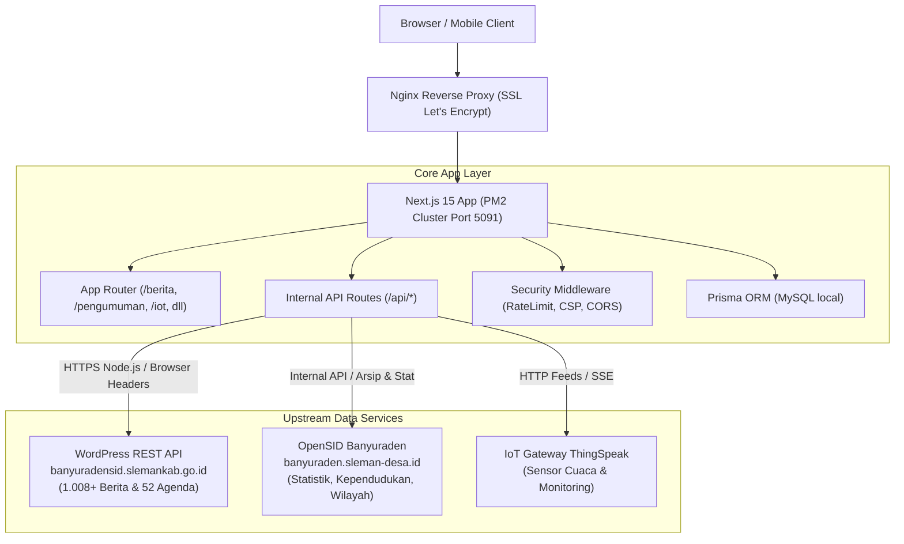

# Arsitektur Sistem — Portal Kalurahan Banyuraden

## 1. Ikhtisar Arsitektur
Portal Kalurahan Banyuraden dibangun menggunakan arsitektur modern berbasis **Next.js 15 (App Router)** yang bertindak sebagai **API Consumer, Presenter, & Aggregator Layer** untuk layanan informasi publik di lingkungan Kalurahan Banyuraden, Kapanewon Gamping, Kabupaten Sleman, D.I. Yogyakarta.

## 2. Komponen & Layanan Utama

### A. Presentation & Application Layer
- **Framework:** Next.js 15.3.4 dengan React Compiler experimental.
- **Styling:** Tailwind CSS v4, Lucide Icons, Shadcn UI Components.
- **Peta Interaktif:** MapLibre GL v5.15 dengan vector GeoJSON batas wilayah resmi Kalurahan Banyuraden (`BANYURADEN.geojson`).

### B. Upstream Integration Strategy
1. **Berita & Pengumuman/Agenda (`banyuradensid.slemankab.go.id`):**
   - Mengonsumsi endpoint `/home/wp-json/wp/v2/posts?_embed=1` dan `/home/wp-json/wp/v2/categories`.
   - Menangani proteksi Cloudflare WAF dengan modul HTTP tingkat server (`lib/slemankab-news.ts`).
   - Menyediakan in-memory caching (TTL 10 menit) untuk respon sub-milidetik.
2. **Kependudukan & Statistik (`banyuraden.sleman-desa.id`):**
   - Menghubungkan endpoint OpenSID internal (`/internal_api/statistik/{id}`, `/internal_api/arsip`).
   - Melayani 15.000+ data statistik agama, pekerjaan, pendidikan, kelompok umur, dan bantuan sosial.
3. **IoT & Monitoring Lingkungan:**
   - Server-Sent Events (SSE) via `/api/iot/stream` dengan fallback pooling ThingSpeak API feeds.

### C. Keamanan & Sanitasi Produksi
- **Sanitasi HTML Dinamis:** `isomorphic-dompurify` membentengi seluruh konten HTML dari celah Stored/Reflected XSS, dengan whitelist selektif untuk blok galeri Gutenberg (`<figure>`, `<figcaption>`).
- **Access Control:** `auth()` session guard memblokir mutasi (POST/PUT/DELETE) tanpa hak akses `ADMIN`.
- **Image Fallback Engine:** Proteksi broken image via `ImageFallback.tsx` dengan fail-safe otomatis ke `banyuraden-cover.jpg`.
